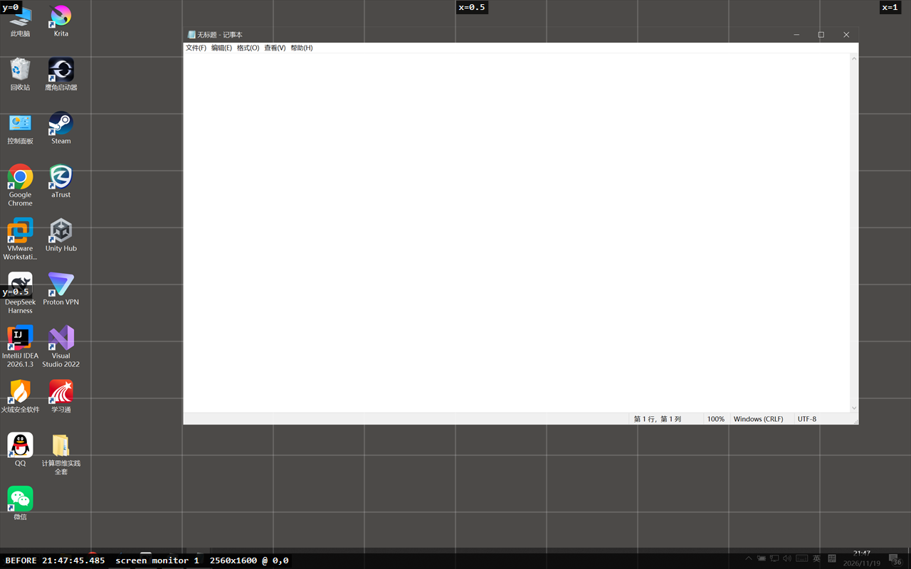

# dsh-see-act · 看屏操作

给 `dsh-see-now` 的实时视野配一双手。

`see_now` 能一直看着屏幕，但它的参数里没有坐标、没有点击、没有键盘——所以在
"边看边点"这件事上它只能看。`real_*`（dsh-plugin-real-input）能点，但每次动作都是一次
独立的截图 + 一次独立的光标操作，模型得来回三四趟才能确认一个按钮到底点没点中。

see-act 把这两件事合成一次调用：

```
一次 see_act  =  截 before（带网格 + 准星） → 真的移动鼠标 / 打字 → 截 after（带准星 + 3× 放大插图）
                 整个过程在同一个 PowerShell 进程里，返回两张图和一句结论
```

模型因此从"截图 → 看图 → 点击 → 截图 → 看图 → 判断"的 3 轮往返，变成 1 轮；
`changed=0` 这类结论直接写在文字里，下一次调用还能读到（图片会被压缩掉，文字不会）。

## 它解决的具体问题

| 问题 | 传统做法 | see-act |
|---|---|---|
| 点完不知道点中没有 | 再截一张图自己看 | 同一次调用返回 after 帧 + `4.2% changed`（或 `no change`） |
| 像素坐标算不准 | 从缩放过的图上数像素，DPR 一错就全错 | 用 `nx/ny`（0..1）瞄准，也可以给 `cell:"3,7"`，物理像素由插件自己算 |
| 小字看不清 | 再截一张放大图 | `see_zoom` 或 after 帧里自带的 3× 插图 |
| 多块屏 | 猜是哪一块 | `screen:"foreground"`（默认，跟当前前台窗口走）/ `primary` / `cursor` / `all` / 序号 |
| 浮窗挡着目标 | 点下去点到浮窗上 | 检测 see-now 浮窗矩形，需要时临时隐藏、点完恢复，并在图上报出这件事 |
| 一次要多步 | 五六次工具调用 | `steps:[…]` 一次最多 8 步（点输入框 → 打中文 → 回车 → 等） |

## 四个工具

| 工具 | 干什么 | 典型耗时（本机 2560×1600 + 1920×1080） |
|---|---|---|
| `see_look` | 立刻截一张带网格/准星/浮窗框/3× 插图的图，不阻塞 | ~1.7s |
| `see_zoom` | 把一个点周围 1:1 的像素放大 2–4 倍，用来读小字 | ~1.3s |
| `see_act` | 真的点击/拖动/滚动/打字/按键/等待/切窗口，返回 before+after | ~2.3s（含 200ms 等待、两张图、插图） |
| `see_stop` | 刹车：`stop` 写一个旗标让下一次 `see_act` 拒绝动手，`clear` 解除，`status` 报当前状态 | <0.1s（status 要探屏，约 1s） |

`see_act` 的 `do` 取值：`click`、`double`、`right`、`middle`、`move`、`scroll`、`drag`、`type`、`key`、`wait`、`focus`。

## 长什么样

真机跑 `node test/accept-real.mjs` 得到的两帧（聚焦记事本 → 打一行中文）：




before 帧回答"我要点哪里"，after 帧回答"点完之后屏幕变成什么样"。两张图都带 0.1 网格和
`x=/y=` 标签，after 帧右下角的 3× 插图是准星周围 1:1 的放大，用来确认准星是不是真的压在了
目标上。

## 坐标契约

**默认用 `nx`/`ny`**（帧的比例，0 是左/上，1 是右/下）。理由很实际：模型看到的图是缩放过的
（1280×720 或 800×450），在上面数像素迟早差几十个像素。比例不受缩放影响。

也接受：

- `{ "x": 1204, "y": 860 }` —— 物理屏幕像素（多屏时是虚拟桌面坐标，见下）；
- `{ "cell": "3,7" }` —— 图上 0.1 网格的第 4 行第 8 格中心，给"就在那一格"的场景用。

返回的每一帧文字里都写着 `monitor 2  1920x1080 @ 2560,145 · image 1280x720 · 1 image px = 1.50 screen px`，
以及 `done x=2982 y=447` 这样的物理坐标，下一次可以直接复用。

## 安装

它和 `dsh-see-now`、`dsh-plugin-real-input` 都是普通 bundle 插件，可以同时装着、互不干扰。

**从市场装**：DSH → 插件 → 插件市场 → 搜「看屏操作」→ 安装。

**手动装**（等价）：

```powershell
& "$env:LOCALAPPDATA\Programs\DeepSeek Harness\resources\runtime\cli\bin\dsh.cmd" `
    plugin --profile desktop add github:cloudylapis/dsh-see-act
```

或者把仓库 clone 下来，用 **插件 → Add plugin** 选那个目录（pnpm 会把依赖和
`dsh.profile.bundles` 一起写好）。

装完**重启 DSH、开一个新会话**再验证：旧会话的工具表不会热更新。

改完代码怎么生效：**不用重启**，让宿主重新 apply 这个插件即可（`plugin_manager` 的
`set_plugin`，target 要用**完整 entryId** `include:dsh-see-act`，用包名会回 `unknown-plugin`）。
如果工具干脆没出现，先看 `list_plugins` 里这条的 `fiberPhase` / `diagnostic`——
`fiberPhase:"failed"` 说明整个插件没挂上（四个工具全没有），原因通常是 schema 不合法，
见 `docs/DETAIL.md` 的「宿主校验」一节。改文件本身不会热重载失败的 fiber。

手动验证（不经过模型）：

```powershell
$env:Path = "$env:USERPROFILE\.dsh\dsh-runtimes\dsh-primary-runtime\dependencies\node\bin;" + $env:Path
cd <这个目录>
node test/e2e-tools.mjs      # 真的会移动鼠标，跑完会解除 stop 旗标
node test/smoke.mjs          # 只截图/标注/等待，不点击
```

## 安全默认

- 每次动作前都检查 `~/.dsh/see-act.stop`；`see_stop({action:"stop"})` 一写，下一次 `see_act` 直接拒绝，
  直到 `see_stop({action:"clear"})`。旗标是文件，跨会话、跨进程都有效。
- 危险组合键默认拒绝：`Win`、`Win+R/X/L/D/E/Tab`、`Ctrl+Alt+Del`、`Ctrl+Shift+Esc`、`Alt+F4`、`Alt+Tab`。
  确实需要时传 `force:true`，并且应当先跟用户确认过。
- 单次最多 8 步、估算总时长超过 60s 的计划直接拒绝；`type` 最多 4000 字符。
- `mode:"readonly"` 只留 `see_look`/`see_zoom`/`see_stop`。
- 动作落点如果落在 see-now 浮窗里，默认先隐藏它再点、点完恢复（`dodge:"hide"`）；也可以用
  `dodge:"off"` 让它老老实实报"这一下会点到浮窗上"。
- 每一步都会写一行旁白到 see-now 的聊天流（`~/.dsh/see-now/chat.jsonl`），用户能在浮窗里看到
  插件刚刚动了哪里；`say` 参数则走语音通道。

## 和 see-now、real-input 的关系

- **不改 see-now 一行代码**。它没有导出活着的采集器，所以 see-act 自己抓图（GDI，DPI-aware），
  只在可选的地方借用它的库：聊天流（`dsh-see-now/chat`）、浮窗 pid（`dsh-see-now/window` 的
  `pidPath()`，或直接读 `~/.dsh/see-now-window.pid`）。
- `see_now` 仍然负责"持续看"；`see_act` 负责"看+动一次"；两个工具在一个会话里可以轮流用。
- 和 `real_*` 不共享状态，各自 spawn 自己的 PowerShell。两者同时动手会互相打断，别这么用。
- 想让 `see_act` 的 before 帧里认出浮窗，装 see-now 即可；浮窗没开时图上就没有红框，一切照常。

### 和 see-now 0.2.x 一起用时要知道的三件事

1. **浮窗默认不在截图里**。see-now 0.2 起给浮窗设了 `WDA_EXCLUDEFROMCAPTURE`：截图、录屏、
   屏幕共享都拍不到它（GDI、`BitBlt`、`PrintWindow`、ffmpeg/ddagrab 一律拍不到 —— 这不是窗坏了，
   是它故意的）。所以 `see_act` 的帧里默认**看不到**浮窗，只能看到我们画的红框。
   想让它出现在帧里（模型能看见自己正踩在什么上）：`~/.dsh/watch-window.json` 写
   `{"capturable": true}`，重开浮窗。分享屏幕时记得改回 `false`。
2. **浮窗要一个带 `tkinter` 且装了 `mss`/`pillow`/`numpy` 的 python**。本机 PATH 上没有 python，
   能用的是 DSH 自带的那个；0.2.x 不会自己去找它（`pythonCandidates()` 只认 `DSH_SEE_PYTHON`、
   `~/.dsh/see-window.json` 的 `python`、以及 PATH 上的 `python(w).exe`）。本机已经这样配好：

   ```
   ~/.dsh/see-window.json  {"python": "C:\\Users\\Administrator\\.dsh\\dsh-runtimes\\dsh-primary-runtime\\dependencies\\python\\python.exe"}
   ```

   那个 python 里已经 `pip install mss`（10.2.0）。缺包时 0.2.5 会弹 MessageBox 并写
   `~/.dsh/watch-window-error.log`（旧版是静默退出）。
3. **避让是按窗口矩形算的，不依赖能不能拍到像素**。浮窗藏在截图外时这条尤其重要：
   `see_act` 用 pid + `FindWindowByPid` 拿矩形、判断落点、必要时 `ShowWindow(0)` 藏起来再点，
   点完先恢复、**再**拍 after 帧（否则模型下一轮会以为窗口凭空消失了）。


## 配置

`~/.dsh/see-act.json`（可选，全部有默认值）：

```json
{
  "mode": "act",              // act | readonly
  "quality": "aim",           // fast 800 / aim 1280 / read 1600
  "screen": "foreground",     // foreground | primary | cursor | all | 序号
  "settleMs": 140,            // 每步后等多久再截 after
  "shots": "both",            // both | after | none
  "zoomInset": true,          // after 帧右下角的 3× 插图
  "dodge": "hide",            // hide | off
  "narrate": true,            // 往 see-now 聊天流写旁白
  "captureFallback": true,    // GDI 拍到全黑时用 ffmpeg/ddagrab 重抓一次
  "maxSteps": 8,
  "maxPlanMs": 60000
}
```

环境变量覆盖（优先级更高）：`DSH_SEE_ACT_MODE`、`DSH_SEE_ACT_QUALITY`、`DSH_SEE_ACT_SCREEN`、
`DSH_SEE_ACT_SETTLE_MS`、`DSH_SEE_ACT_NARRATE`、`DSH_SEE_ACT_NO_DODGE`、`DSH_SEE_ACT_CONFIG`、
`DSH_SEE_ACT_FRAMES`、`DSH_SEE_ACT_STOP`。

## 已知边界

- **只用 Windows**（P/Invoke + PowerShell 5.1 + System.Drawing），`os: ["win32"]`。
- GDI 抓不到硬件叠层（部分视频播放器、受保护内容）；这时会自动退回 ffmpeg 的 `ddagrab`
  （只覆盖主屏、无标注），并在文字里说明。
- 输入走 SendInput：普通 Win32/WPF/UWP 应用都行；少数全屏游戏/反作弊程序会忽略合成输入。
- 一次最多 8 步；超过 3 步时 before/after 只反映首尾（文字里会提醒）。
- 浮窗避让依赖它的窗口矩形，不依赖它是否真的画出了像素。

更多实现细节见 [docs/DETAIL.md](docs/DETAIL.md)。

## 开发

```powershell
node --test "test/*.test.mjs"   # 纯逻辑单测（几何/步骤/配置/旗标/工具形状），不碰屏幕
node test/e2e-tools.mjs          # 端到端：真的截图、移动鼠标、arm/clear 刹车
node test/smoke.mjs              # PowerShell 层：probe/look/zoom/act 四种动作
node test/accept-real.mjs        # 真机验收：打开记事本 → 聚焦 → 打中文 → 存两张帧到 %TEMP%\see-act-accept
```

MIT。见 [NOTICE](NOTICE)。
